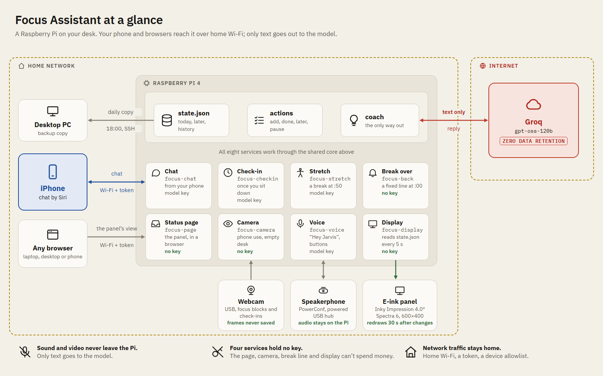

# focus-assistant

A focus coach that lives on your desk. A Raspberry Pi checks in three times
each workday, looks at your priorities and what has happened since the last
check-in, and asks an open language model for a short, specific nudge: what to start with,
how the morning went, what carries over to tomorrow. Everything else is
optional and built around one idea: **help you focus without picking up
your phone.**

```
09:00  MORNING CHECK-IN
       Start with the quarterly report: it has carried over three days, so
       give it the first block before email. Leave the phone on its
       charger until the 10:50 break.
```

<picture>
  <source media="(prefers-color-scheme: dark)" srcset="docs/diagrams/architecture-simple-dark.png">
  
</picture>

More diagrams, including a weekday timeline, are in
[docs/architecture.md](docs/architecture.md).

## What it can do

| | Needs |
|---|---|
| **Check-ins** at 09:00, 13:00 and 17:30 on weekdays; **weekly goals**, a **weekly wrap-up** on Friday evening with a suggested change to your routine, and a Monday check-in that opens the week | a Pi and a key for a hosted open model |
| **Priorities** from the command line: `focus add`, `focus done`, `focus move` ... unfinished ones carry over, and the coach notices when something keeps slipping | nothing extra |
| **Spoken check-ins** and **stretch reminders** (50 minutes of work, 10 of break) | a USB speaker |
| **Voice commands** at the desk: "Hey Jarvis, done with the report, what's next?", plus buttons on a speakerphone | a USB speakerphone |
| A **status page** that previews the e-ink display in a browser while the panel is on its way, for development: today's top three, the coach's last words, focus block, phone, breaks | nothing extra |
| **Phone pickups**: it notices when you take your phone off its charger during focus time | your usual charger (pad or cable), iOS Shortcuts |
| **Chat** with the coach from your phone, typed or through Siri | iOS Shortcuts |
| **Pause** for a meeting or a few days off: "quiet until 11", "off until Monday" | nothing extra |
| **Presence**: it holds a check-in until you're back at the desk instead of talking to an empty room | phone pickups (and the speakerphone, for desk sound) |
| An **e-ink display** (Pimoroni Inky Impression 4") | the panel. Code written and previewed, not yet tested on real hardware. |

It runs on a Raspberry Pi 4 with Raspberry Pi OS Lite (64-bit), and should
run on any Debian-based Linux machine. The voice features are tuned for an
Anker PowerConf speakerphone; other USB speakerphones should work with some
setup (see [docs/voice.md](docs/voice.md)).

## Quick start

You need a Raspberry Pi 4 (2 GB or more), a microSD card, and an account
with a host for open models that offers an OpenAI-compatible API (Groq,
Together, OpenRouter, Fireworks, DeepInfra and others), with its base URL,
an API key and the name of the model to use.

1. Flash **Raspberry Pi OS Lite (64-bit)** with Raspberry Pi Imager. In its
   settings, set a hostname, user, Wi-Fi, SSH and **your time zone**: the
   check-ins run on the Pi's clock.
2. Log in and install:
   ```bash
   ssh <user>@<hostname>.local
   sudo apt update && sudo apt full-upgrade -y
   sudo apt install -y git python3-venv fonts-dejavu-core
   git clone https://github.com/nthnle/focus-assistant.git && cd focus-assistant
   sudo deploy/install.sh
   ```
3. Set the model, then run a check-in:
   ```bash
   sudo nano /etc/focus-assistant/focus.env      # FOCUS_LLM_BASE_URL, FOCUS_LLM_API_KEY, FOCUS_MODEL
   focus add Write the project proposal
   sudo systemctl start focus-checkin
   focus last                                    # the coach's reply
   ```

From then on the check-ins run on their own. `focus status` shows what's
running, what's next and what today has cost. The full walkthrough,
including updating and troubleshooting, is in
[docs/install.md](docs/install.md).

## Using it

```bash
focus add Finish the quarterly report
focus show            # numbered list; * marks the top 3 open, the ones the coach and display focus on
focus done 1          # numbers are positions in `focus show`
focus move 4 1        # put #4 at the top
focus edit 2 Email Sam the budget
focus drop 3
focus report drifted  # or on-track: tell the coach how the block is going
focus pause 11:00     # quiet for a meeting; also 45m, 2pm, tomorrow, monday, 2026-10-24
focus resume
focus add --on wed Book the dentist    # off today's list until Wednesday (or tomorrow, a date, later)
focus later 3 friday  # move #3 to Friday; without a day, to "someday"
focus now 5           # bring a later one back to today
focus goal add Ship the beta           # one to three goals for the week
focus goal done 1     # also: focus goal drop 1, focus goals
focus rate bad it ignored the weekend   # or good: feedback on the coach's latest reply
focus feedback        # replies rated bad or failing a check, last 14 days
focus last            # the latest check-in
focus status          # services, next timers, today, presence and API cost
```

Each morning, unfinished priorities carry over with a "days carried" count,
and finished ones go into a 14-day history the coach uses for context. A
day counts only if a check-in ran on it, and only for priorities that were
on the list by its last check-in: weekends, days off and tomorrow's plan
added in the evening don't make anything look like it slipped. Keep to
about three: the coach pushes back when you have more.

**Pausing.** `focus pause` (or telling the coach "quiet until 11" or "I'm
off until Monday", by chat or voice) holds stretch reminders and spoken
check-ins. A check-in during a short pause still runs and shows on the
screen; it's spoken once the pause ends. On days you're paused through,
check-ins are skipped entirely, so a holiday costs nothing and doesn't count
toward carried days.

**Weeks.** Set one to three goals for the week (`focus goal add`, or tell
the coach on Monday; goals set on a Saturday or Sunday are for the week
ahead). The coach ties the day's priorities to them, and on
Friday evening the check-in becomes a wrap-up: which goals were met, what
kept slipping, and one concrete change to your routine, grounded in a
pattern from the week (pickups bunching after lunch, things getting done
late). Monday's first check-in recalls that suggestion and asks for the new
week's goals. If Friday's wrap-up didn't happen (a day off, the Pi was
off), Monday morning does a short version first. You can also ask for
routine suggestions any time, by chat or voice.

**Improving the coach.** Every reply the model writes is kept on the Pi for
60 days in `replies.jsonl`, next to exactly what the coach was given, and
checked against the rules code can verify (length, no markdown, a morning
check-in that names a priority, short on weekends). Rate replies with
`focus rate good|bad`, or tell the coach "that was wrong". `focus feedback`
lists what was rated bad or failed a check: bring those to the next round
of changes to the prompts or code. The loop is drawn in
[docs/architecture.md](docs/architecture.md).

## Guides

| Guide | Covers |
|---|---|
| [docs/install.md](docs/install.md) | Full setup, updating, the check-in schedule, troubleshooting |
| [docs/voice.md](docs/voice.md) | Speaker, spoken check-ins, voice commands, wake word, speakerphone buttons, stretch reminders, quiet hours |
| [docs/phone.md](docs/phone.md) | Phone pickups, chat from your phone, the status page, presence |
| [docs/configuration.md](docs/configuration.md) | Every setting in `focus.env` |
| [docs/backup.md](docs/backup.md) | A daily copy of `state.json` to another computer, with a key that can only read that file |
| [docs/architecture.md](docs/architecture.md) | How it fits together, security model, adding your own inputs and outputs, development |

## Cost

The coach runs on whichever open model and host you set, so the cost is
the host's price. Hosted open models are cheap for replies this short: with
three check-ins a day and a handful of voice commands, usually **well under
a dollar a month**. You can give chat, voice and stretch reminders a smaller,
faster model (`FOCUS_CHAT_MODEL`). Set the prices in `focus.env` and
`focus status` shows the day's cost from the token counts it records; phone
chat has a daily cap (50 messages by default). If the host can't be reached,
check-ins fall back to a fixed nudge built from your priorities.

## Privacy

- **Your data stays on the Pi**, in one JSON file (and a 60-day log of the
  coach's replies, for improving it), except what is sent to
  the model host you chose, to write each reply: your priorities, today's
  events and check-ins, and recent daily summaries. Check that host's data
  retention policy.
- **Speech never leaves the Pi.** Speech recognition (faster-whisper or
  Moonshine), text-to-speech (Piper) and the wake word (openWakeWord) all run
  locally; only the transcribed text goes to the coach.
- **With voice enabled, the microphone stream is always open**, but its
  audio is discarded unless you've pressed the button or said the wake
  word. The only thing kept from it is the time the desk last made a sound,
  used for presence. A speakerphone's mute button, or the nightly quiet
  hours (voice off from 00:00 to 08:00), turn it off completely.
- **The network services listen on your home network only**, each behind
  its own token. Of the two, only chat holds the model key; the service that
  receives charger reports (`focus-dock`) and the status page can't spend
  money. Every service runs sandboxed with only the access
  it needs. Details in [docs/architecture.md](docs/architecture.md).

## Status

A personal project, shared as is. It's used daily on a Raspberry Pi 4 with
an Anker PowerConf speakerphone and an iPhone. Other hardware is untested,
and the e-ink display code hasn't met a real panel yet. Issues and pull
requests are welcome.

## Development

```bash
python -m venv .venv && .venv/bin/pip install -e ".[dev]"
.venv/bin/pytest
```

The tests mock the API and all hardware, so they need no key, no network and
no Pi. They also run on Windows and macOS.

## License

MIT, see [LICENSE](LICENSE). The optional components it installs have their
own licenses: notably `piper-tts` is GPL-3.0, and openWakeWord's pre-trained
wake-word models are licensed for non-commercial use only. Piper voices and
speech models each come with their own model cards; check them before any
commercial use.
