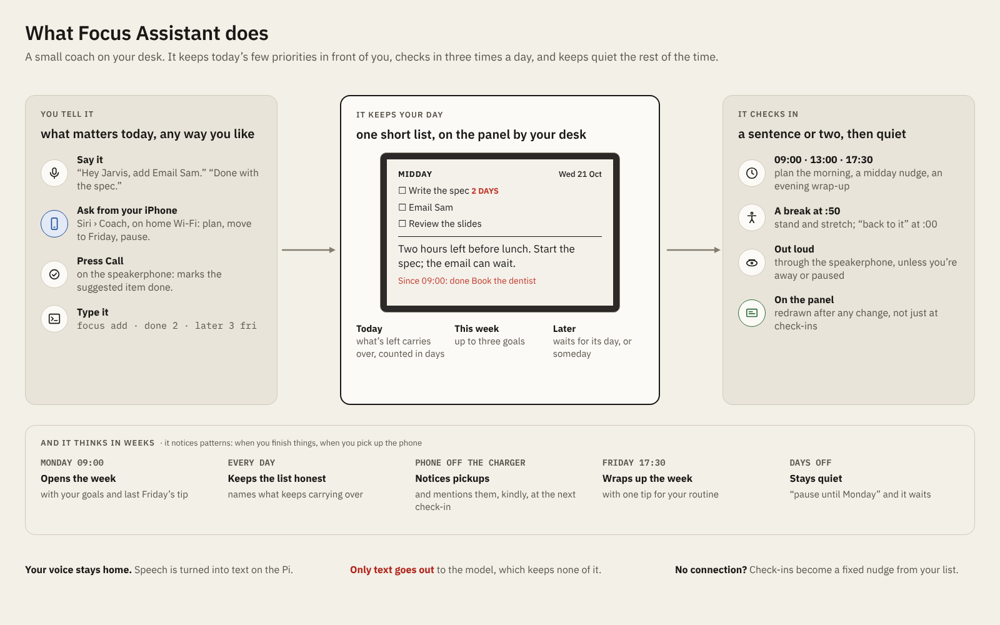

# focus-assistant

A focus coach that lives on your desk. A Raspberry Pi checks in three times
each workday, looks at your to-do list and what has happened since the last
check-in, and asks an open language model for a short, specific nudge: what to start with,
how the morning went, what carries over to tomorrow. Everything else is
optional and built around one idea: **help you focus without picking up
your phone.**

```
09:00  MORNING CHECK-IN
       Start with the quarterly report: it has carried over three days, so
       give it the first block before email. Leave the phone face down
       until the 10:50 break.
```

<picture>
  <source media="(prefers-color-scheme: dark)" srcset="docs/diagrams/what-it-does-dark.png">
  
</picture>

How the parts fit:

<picture>
  <source media="(prefers-color-scheme: dark)" srcset="docs/diagrams/architecture-simple-dark.png">
  
</picture>

More diagrams, including a weekday timeline, are in
[docs/architecture.md](docs/architecture.md).

## What it can do

| | Needs |
|---|---|
| **Check-ins** at 09:00, 13:00 and 17:30 on weekdays; a **weekly wrap-up** on Friday evening with a suggested change to your routine, and a Monday check-in that opens the week | a Pi and a key for a hosted open model |
| A **to-do list** (not ranked) from the command line: `focus add`, `focus done`, `focus later` ... unfinished items carry over, each check-in suggests one to start with, and the coach notices when something keeps slipping | nothing extra |
| **Spoken check-ins** and **stretch reminders** (50 minutes of work, 10 of break) | a USB speaker |
| **Voice commands** at the desk: "Hey Jarvis, done with the report", "what should I do now?", plus buttons on a speakerphone | a USB speakerphone |
| A **status page**: the e-ink panel's view in any browser on your network (laptop, desktop or phone), with a status strip under it (focus block, phone, breaks) and a list editor for when voice mishears you | nothing extra |
| **Phone use**: a desk camera notices when you pick up your phone during focus time, and after 5 minutes on it the coach says so | a USB webcam, and a PC to train its model once on your own desk |
| **Chat** with the coach from your phone, typed or through Siri | an iOS Shortcut |
| **Pause** for a meeting or a few days off: "quiet until 11", "off until Monday" | nothing extra |
| **Presence**: it holds a check-in until you're back at the desk instead of talking to an empty room | the desk camera |
| An **e-ink display** that redraws when your list or the coach's reply changes | a Pimoroni Inky Impression 4.0" (Spectra 6), on the Pi or on a ribbon |

It runs on a Raspberry Pi 4 with Raspberry Pi OS Lite (64-bit), and should
run on any Debian-based Linux machine. The voice features are tuned for an
Anker PowerConf speakerphone; other USB speakerphones should work with some
setup (see [docs/voice.md](docs/voice.md)).

## Quick start

You need a Raspberry Pi 4 (2 GB or more), a microSD card, and an account
with a host for open models that offers an OpenAI-compatible API (Groq,
Together, OpenRouter, Fireworks, DeepInfra and others), with its base URL,
an API key and the name of the model to use.

1. Flash **Raspberry Pi OS Lite (64-bit)** with Raspberry Pi Imager. In its
   settings, set a hostname, user, Wi-Fi, SSH and **your time zone**: the
   check-ins run on the Pi's clock.
2. Log in and install:
   ```bash
   ssh <user>@<hostname>.local
   sudo apt update && sudo apt full-upgrade -y
   sudo apt install -y git python3-venv fonts-dejavu-core
   git clone https://github.com/nthnle/focus-assistant.git && cd focus-assistant
   sudo deploy/install.sh
   ```
3. Set the model, then run a check-in:
   ```bash
   sudo nano /etc/focus-assistant/focus.env      # FOCUS_LLM_BASE_URL, FOCUS_LLM_API_KEY, FOCUS_MODEL
   focus add Write the project proposal
   sudo systemctl start focus-checkin
   focus last                                    # the coach's reply
   ```

From then on the check-ins run on their own. `focus status` shows what's
running, what's next and what today has cost. The full walkthrough,
including updating and troubleshooting, is in
[docs/install.md](docs/install.md).

## Using it

What to do and when, on one page: [docs/routine.md](docs/routine.md).

```bash
focus add Finish the quarterly report
focus show            # the list, numbered in the order you added things (not a ranking)
focus done 1          # numbers are positions in `focus show`
focus edit 2 Email Sam the budget
focus drop 3
focus report drifted  # or on-track: tell the coach how the block is going
focus pause 11:00     # quiet for a meeting; also 45m, 2pm, tomorrow, monday, 2026-10-24
focus resume
focus add --on wed Book the dentist    # off today's list until Wednesday (or tomorrow, a date, later)
focus later 3 friday  # move #3 to Friday; without a day, to "someday"
focus now 5           # bring a later one back to today
focus rate bad it ignored the weekend   # or good: feedback on the coach's latest reply
focus feedback        # replies rated bad or failing a check, last 14 days
focus last            # the latest check-in
focus status          # services, next timers, today, presence and API cost
```

Each morning, unfinished items carry over with a "days carried" count,
and finished ones go into a 14-day history the coach uses for context. A
day counts only if a check-in ran on it, and only for items that were
on the list by its last check-in: weekends, days off and tomorrow's plan
added in the evening don't make anything look like it slipped. After
three days carried, the coach suggests shrinking, rescheduling or dropping
the item.

**Pausing.** `focus pause` (or telling the coach "quiet until 11" or "I'm
off until Monday", by chat or voice) holds stretch reminders and spoken
check-ins. A check-in during a short pause still runs and shows on the
screen; it's spoken once the pause ends. On days you're paused through,
check-ins are skipped entirely, so a holiday costs nothing and doesn't count
toward carried days.

**Weeks.** On Friday evening the check-in becomes a wrap-up: what got
done, what kept slipping, and one concrete change to your routine, grounded
in a pattern from the week (pickups bunching after lunch, things getting
done late). Monday's first check-in recalls that suggestion. If Friday's
wrap-up didn't happen (a day off, the Pi was
off), Monday morning does a short version first. You can also ask for
routine suggestions any time, by chat or voice.

**Improving the coach.** Every reply the model writes is kept on the Pi for
60 days in `replies.jsonl`, next to exactly what the coach was given, and
checked against the rules code can verify (length, no markdown, a morning
check-in that suggests an item, short on weekends). Rate replies with
`focus rate good|bad`, or tell the coach "that was wrong". `focus feedback`
lists what was rated bad or failed a check: bring those to the next round
of changes to the prompts or code. The loop is drawn in
[docs/architecture.md](docs/architecture.md).

## Guides

| Guide | Covers |
|---|---|
| [docs/routine.md](docs/routine.md) | Day to day: what to do every workday, every week and now and then, with a one-page desk card |
| [docs/install.md](docs/install.md) | Full setup, updating, the check-in schedule, troubleshooting |
| [docs/voice.md](docs/voice.md) | Speaker, spoken check-ins, voice commands, wake word, speakerphone buttons, stretch reminders, quiet hours |
| [docs/camera.md](docs/camera.md) | The desk camera: phone use, the phone nudge, an empty desk; recording, training, privacy |
| [docs/phone.md](docs/phone.md) | Chat from your phone, the status page, presence |
| [docs/configuration.md](docs/configuration.md) | Every setting in `focus.env` |
| [docs/backup.md](docs/backup.md) | A daily copy of `state.json` to another computer, with a key that can only read that file |
| [docs/architecture.md](docs/architecture.md) | How it fits together, security model, adding your own inputs and outputs, development |

## Cost

The coach runs on whichever open model and host you set, so the cost is
the host's price. Hosted open models are cheap for replies this short: with
three check-ins a day and a handful of voice commands, usually **well under
a dollar a month**. You can give chat, voice and stretch reminders a smaller,
faster model (`FOCUS_CHAT_MODEL`). Set the prices in `focus.env` and
`focus status` shows the day's cost from the token counts it records; set a
spend limit at your model host if it offers one. If the host can't be reached,
check-ins fall back to a fixed nudge built from your list.

## Privacy

- **Your data stays on the Pi**, in one JSON file (and a 60-day log of the
  coach's replies, for improving it), except what is sent to
  the model host you chose, to write each reply: your list, today's
  events and check-ins, your last few chat or voice messages and their
  replies, and recent daily summaries. Check that host's data retention
  policy.
- **Speech never leaves the Pi.** Speech recognition (faster-whisper or
  Moonshine), text-to-speech (Piper) and the wake word (openWakeWord) all run
  locally; only the transcribed text goes to the coach.
- **Camera frames never leave the Pi and are never saved.** The desk
  camera runs around focus blocks; each frame is classified on the Pi
  (phone, work or away) and thrown away. Only the times you picked up and
  put down the phone are kept. The frames you record to train it, and the
  model, stay on your own machines ([docs/camera.md](docs/camera.md#privacy)).
- **With voice enabled, the microphone stream is always open**, but its
  audio is discarded unless you've pressed the button or said the wake
  word. Nothing from it is kept. A speakerphone's mute button, or the
  nightly quiet hours (voice off from 00:00 to 08:00), turn it off
  completely.
- **The network services listen on your home network only**, each behind
  its own token. Of the two, only chat holds the model key; the status page
  (`focus-page`) can't spend money. Every service runs sandboxed with only the access
  it needs. Details in [docs/architecture.md](docs/architecture.md).

## Status

A personal project, shared as is. It's used daily on a Raspberry Pi 4 with
an Anker PowerConf speakerphone, an Inky Impression 4.0" Spectra 6, a Lenovo
USB webcam and an iPhone. Other hardware is untested. Issues and pull requests are welcome.

## Development

```bash
python -m venv .venv && .venv/bin/pip install -e ".[dev]"
.venv/bin/pytest
```

The tests mock the API and all hardware, so they need no key, no network and
no Pi. They also run on Windows and macOS.

## License

MIT, see [LICENSE](LICENSE). The optional components it installs have their
own licenses: notably `piper-tts` is GPL-3.0, and openWakeWord's pre-trained
wake-word models are licensed for non-commercial use only. Piper voices and
speech models each come with their own model cards. The desk camera's model
is trained starting from torchvision's MobileNetV3 weights, pretrained on
ImageNet, whose terms are for non-commercial research. Check all of these
before any commercial use.
