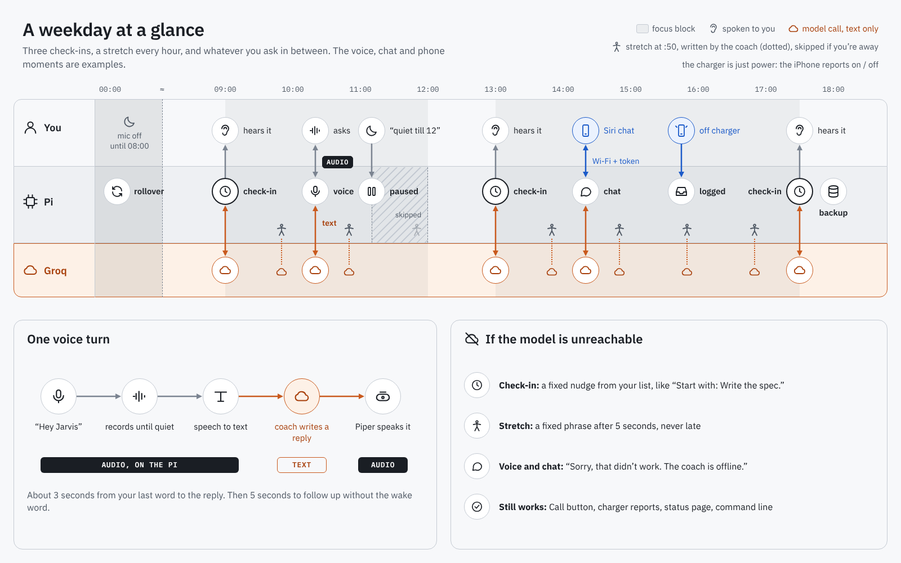
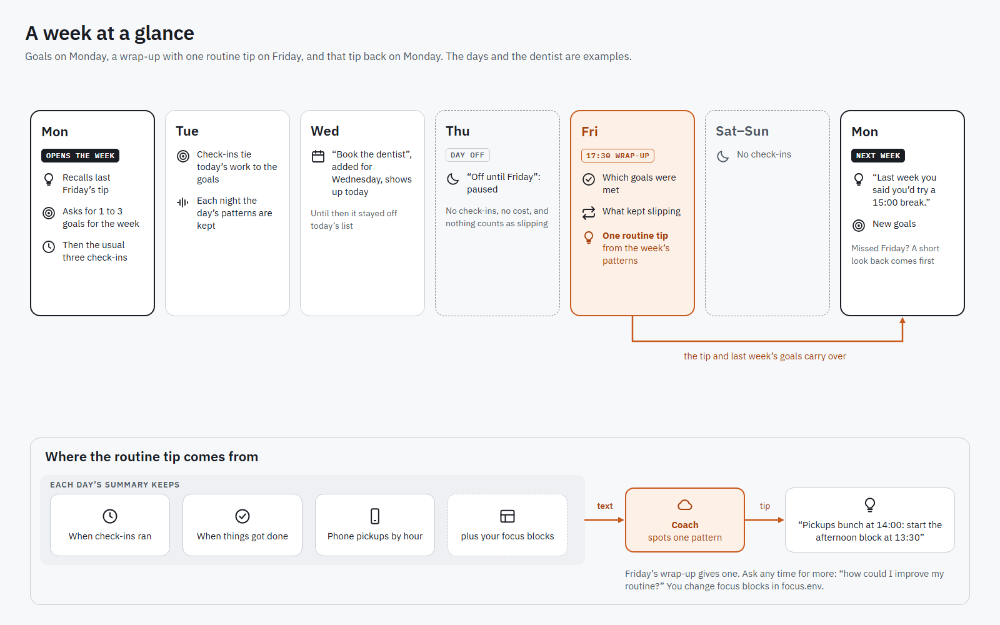
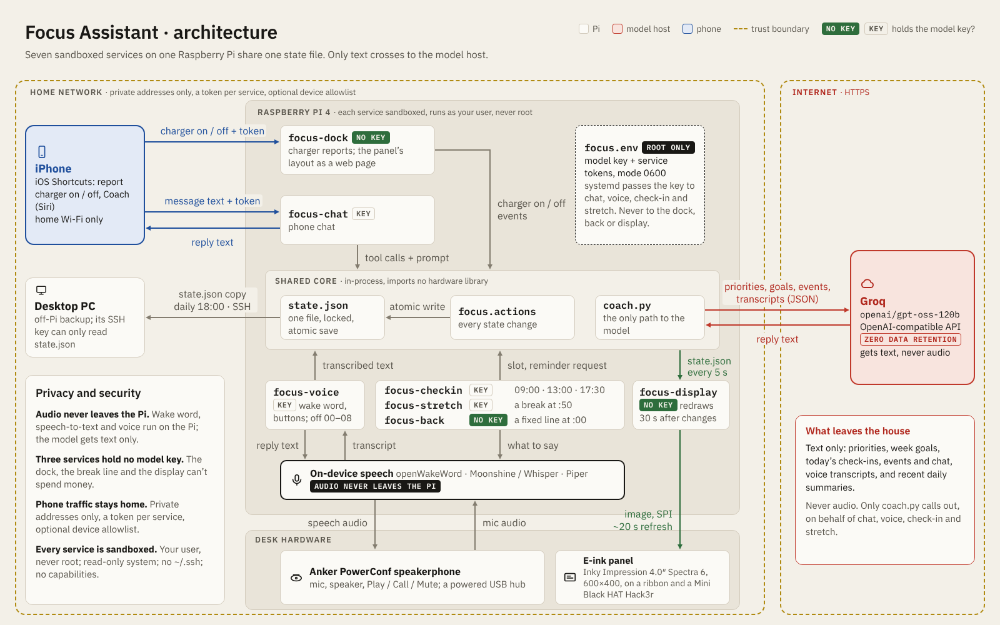
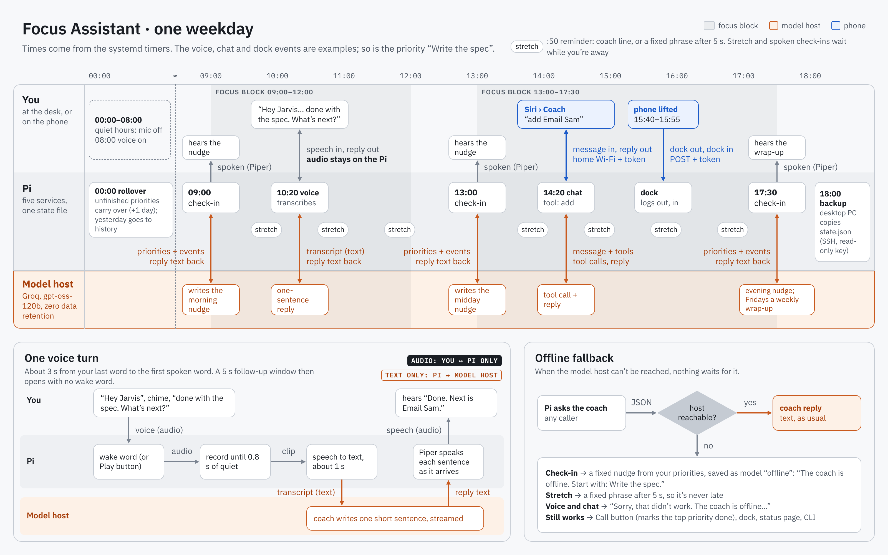

# Architecture

How the pieces fit together, what each service is allowed to do, and how to
add your own inputs and outputs.

## Overview

At a glance:

<picture>
  <source media="(prefers-color-scheme: dark)" srcset="diagrams/architecture-simple-dark.png">
  
</picture>

<picture>
  <source media="(prefers-color-scheme: dark)" srcset="diagrams/workflow-simple-dark.png">
  
</picture>

<picture>
  <source media="(prefers-color-scheme: dark)" srcset="diagrams/week-simple-dark.png">
  
</picture>

In detail:

<picture>
  <source media="(prefers-color-scheme: dark)" srcset="diagrams/architecture-dark.png">
  
</picture>

<picture>
  <source media="(prefers-color-scheme: dark)" srcset="diagrams/workflow-dark.png">
  
</picture>

The sources are the HTML files in [`diagrams/`](diagrams/) (1600x1000, light
or dark from the browser's setting); [`diagrams/README.md`](diagrams/README.md)
says how to re-export the PNGs after an edit. The "dock" in them is just the phone's
usual charger; `focus-dock` is the Pi service that logs what the iPhone
reports about it. The drawings describe one setup: Groq
running `openai/gpt-oss-120b`, an Anker PowerConf on a powered USB hub, and
a desktop PC that copies `state.json` at 18:00.

```
                    ┌───────────────── state.json ─────────────────┐
                    │ priorities · check-ins · events · chat ·     │
                    │ 14-day history          (file lock, atomic)  │
                    └───────▲──────────────▲───────────────▲───────┘
                            │              │               │
  timers                    │   inputs     │      outputs  │
  ───────                   │   ──────     │      ───────  │
  focus-checkin  ──► coach ─┤   dock  ─────┤      console ◄┤
  focus-stretch  ──► coach ─┤   chat  ─────┤      speech  ◄┤
                            │   voice ─────┤      inky    ◄┘
  you ─► focus CLI ─────────┘   (all call focus.actions)
```

- **One state file** (`state.json`) holds everything. Every reader and
  writer goes through `state.locked_state()`, which takes an exclusive file
  lock for the whole read-modify-write and saves atomically (write, then
  rename), so a power cut never leaves a half-written file.
- **Day rollover** happens in code at the first use each day: unfinished
  priorities carry over (`carried_days + 1`, if a check-in ran that day and
  they were on the list by then), a summary of the day goes into `history`
  (with the patterns routine suggestions need: check-in times, when things
  got done, phone pickups by hour), and the day's check-ins, events and chat
  are cleared. Priorities scheduled for another day wait in the same list
  until their day. At the first rollover of a new week, the week's goals and
  Friday's review move into `last_week` for Monday's check-in.
- **`focus.actions`** is every state change (add, rename, schedule,
  complete, reopen, drop, move, goals, pause, resume, log an event). The
  CLI, chat tools, voice and buttons all call it, so behaviour is the same
  whichever input you use.
- **The coach** (`coach.py`) is a single chat-completions call per check-in,
  to an open model on any OpenAI-compatible host. It gets a JSON payload:
  priorities, today's check-ins, events and chat, and the last five daily
  summaries. The lock is never held during a model call. `<think>` text from
  reasoning models is stripped, streamed or not. If the host can't be
  reached, the check-in is a fixed nudge built from the same data
  (`offline_reply`), recorded with model `offline`.
- **Chat** (`chat.py`) adds a small tool loop: the model can change
  priorities only through thirteen tools that call `focus.actions`, at most six
  model calls per message. Open models don't always follow a tool schema,
  so every argument is checked (JSON, whole-number ids, known values,
  length) before anything changes. Earlier turns are replayed as plain text.

## Modules

```
focus/
  state.py        state.json: locked read-modify-write, atomic save, rollover
  actions.py      every state change; all inputs call these
  config.py       settings from FOCUS_* environment variables
  coach.py        check-in prompt, payload, and the shared API call
  chat.py         chat: prompt, tools, tool loop, daily limit
  checkin.py      one scheduled check-in: snapshot -> coach -> record -> outputs
  stretch.py      the :50 stretch reminder (coach-written, fixed fallback)
  presence.py     away or not, from charger events and desk sound
  pause.py        "quiet until 11" and days off: when check-ins and reminders wait
  days.py         "tomorrow", "wed", "2026-10-24": days for pauses and later priorities
  feedback.py     replies.jsonl: every model reply with its payload, checks and ratings
  blocks.py       focus blocks (FOCUS_BLOCKS)
  display.py      the status page (HTML)
  status.py       `focus status`
  bench.py        voice benchmark
  cli.py          the `focus` command
  outputs/        where a check-in goes: console, speech, inky
  inputs/         long-running services: dock, chat, voice (+ _web helpers)
deploy/           systemd units, udev rule, focus.env.example, install.sh
tests/
```

The core (`state`, `actions`, `coach`, `checkin`) imports no hardware
library. Hardware libraries (Piper, faster-whisper, openWakeWord, Inky) are
imported only by the modules that use them, and only when used.

## Services and what they may do

Each service is a systemd unit running as your user (never root) in a
sandbox: a read-only system, an empty home directory with only the state
directory in it (so not even `~/.ssh` is visible),
no capabilities, no new privileges, and only the devices and network it
needs. The API key lives in `/etc/focus-assistant/focus.env`, readable by
root only; systemd reads it and passes it to the services that need it.

| Unit | Runs | API key | Network | Devices |
|---|---|---|---|---|
| `focus-checkin` | timer: 09:00, 13:00, 17:30 weekdays | yes | outbound | sound cards |
| `focus-stretch` | timer: :50 each weekday hour | yes | outbound | sound cards |
| `focus-dock` | always (charger reports from the iPhone + the status page, a browser preview of the e-ink display) | **no** | home network only, inbound | none |
| `focus-chat` | always | yes, capped by a daily limit | home network inbound, API outbound | none |
| `focus-voice` | always, except quiet hours | yes | outbound | sound cards, input devices (read), hidraw (read) |

Two small helper units, `focus-voice-sleep` and `focus-voice-wake`, run as
root only to stop and start `focus-voice` at the quiet-hours times.

The two services that listen on the network (`dock`, `chat`) answer only
private addresses and require their own token (`Authorization: Bearer`, or
`?k=` for the status page), optionally narrowed to listed devices with
`FOCUS_ALLOWED_CLIENTS`. Requests are plain HTTP on your LAN.

## Adding an output

An output is a module in `focus/outputs/` with a `create()` function
returning an object that has:

```python
def checkin(self, state: State, slot: str, reply: str) -> None: ...
```

Enable it by name: `FOCUS_OUTPUTS=console,speech,yourmodule`. Outputs run in
order after each check-in; a failing output is logged and skipped, and never
stops the others. See `outputs/console.py` for the smallest example.

## Adding an input

An input is anything that calls `focus.actions` inside
`focus.state.locked_state()`:

```python
from focus import actions, config, state as st

with st.locked_state(config.load()) as s:
    actions.add_priority(s, "Call the dentist")
```

Long-running inputs get their own systemd unit, so a crash in one never
affects the check-ins. For a network input, `focus/inputs/_web.py` has the
token check and server loop that the dock and chat use.

## E-ink display

`outputs/inky.py` draws the check-in for a Pimoroni **Inky Impression 4"**
(640x400, 7 colours): the slot and date, the top three open priorities (a
red tag shows days carried) and the reply, shrinking from 24 px to 16 px to
fit. It redraws only when something changed, since a full refresh takes
about 30 seconds. **It hasn't been tested on a real panel yet.**

Preview it on any machine, without the panel or an API call:

```bash
.venv/bin/python -m focus.outputs.inky preview.png     # redraws the last check-in
```

To use the panel: `sudo raspi-config nonint do_spi 0`, install the
`display` extra, set `FOCUS_OUTPUTS=console,inky`, and give the check-in
unit access to SPI and GPIO (see the comment in
[`deploy/focus-checkin.service`](../deploy/focus-checkin.service)).

## Development

```bash
python -m venv .venv && .venv/bin/pip install -e ".[dev]"
.venv/bin/pytest
```

The tests mock the model host (with `httpx.MockTransport`) and all hardware
(microphone, buttons, `aplay`, systemd), so they need no key, no network and
no Pi, and they run on Linux, macOS and Windows. The speech libraries aren't
needed for the tests either.

Conventions worth keeping:

- every state change goes through `focus.actions`
- never hold the state lock during a network call or a model call
- services get only the access they need; new devices or network access
  mean a matching change to the unit's sandbox settings
- replies are plain text, short, and markdown-free, so the same text works
  on e-ink and through a speaker
