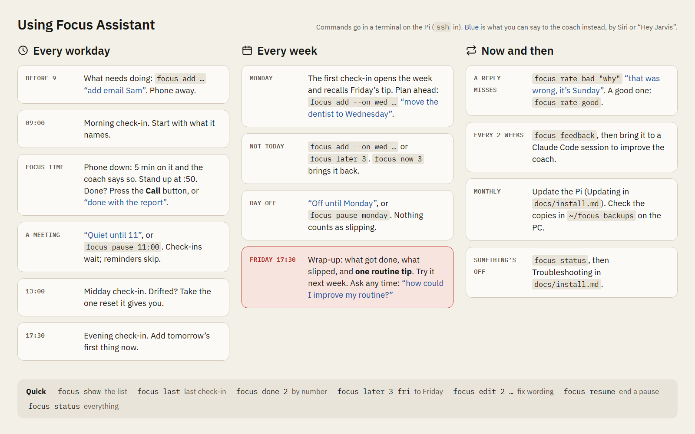

# Day to day

What to do, and when. The same on one page, to print or keep on your
phone: [diagrams/cheatsheet.png](diagrams/cheatsheet.png).

<picture>
  <source media="(prefers-color-scheme: dark)" srcset="diagrams/cheatsheet-dark.png">
  
</picture>

Commands run on the Pi (`ssh` in). Most things can also be said to the
coach, from your phone ("Hey Siri, Coach") or at the desk ("Hey Jarvis").

## Every workday

| When | Do |
|---|---|
| Before 09:00 | Put what you need to get done on the list: `focus add Write the spec`, or "add email Sam". It isn't ranked. Phone out of reach. |
| 09:00 | Listen to the morning check-in: it suggests one item to start with, and why. |
| Focus time | Leave the phone alone: the camera counts each pickup, and the coach speaks up after 5 minutes on it. Stand up when the :50 reminder says so. Finished something? Say "done with the report", or, if it's the one the check-in suggested, press the speakerphone's **Call** button. |
| A meeting or call | "Quiet until 11", or `focus pause 11:00`. Check-ins wait until it ends; stretch reminders are skipped. |
| 13:00 | Midday check-in. If you drifted, take the one reset it gives you. |
| 17:30 | Evening check-in. Add tomorrow's first thing now (it won't count as slipping). |

## Every week

| When | Do |
|---|---|
| Monday | The first check-in opens the week and recalls Friday's tip. |
| Something not for today | `focus add --on wed Book the dentist`, or `focus later 3` (to "someday"). `focus now 3` brings it back. |
| A day off | "Off until Monday", or `focus pause monday`. No check-ins, no cost, nothing counts as slipping. |
| Friday 17:30 | The wrap-up: what got done, what slipped, and one routine tip. Try the tip the next week; to move focus blocks, edit `FOCUS_BLOCKS` in `/etc/focus-assistant/focus.env`. Ask for more any time: "how could I improve my routine?" |

## Now and then

| When | Do |
|---|---|
| A reply misses | `focus rate bad "it's Sunday"`, or tell the coach "that was wrong". A good one: `focus rate good`. |
| Every two weeks | `focus feedback`, then bring the output to a Claude Code session to improve the coach. |
| Monthly | Update the Pi ([install.md, Updating](install.md#updating)). Check that new copies are arriving in `~/focus-backups` on the PC ([backup.md](backup.md)). `focus status` shows the day's API cost. |
| Something's off | `focus status`, then [Troubleshooting](install.md#troubleshooting). |

## Quick reference

```bash
focus show            # the list, numbered in the order you added things
focus last            # the latest check-in
focus done 2          # by its number in `focus show`
focus edit 2 Email Sam the budget
focus resume          # end a pause
focus status          # services, today, pauses, replies, cost
```
