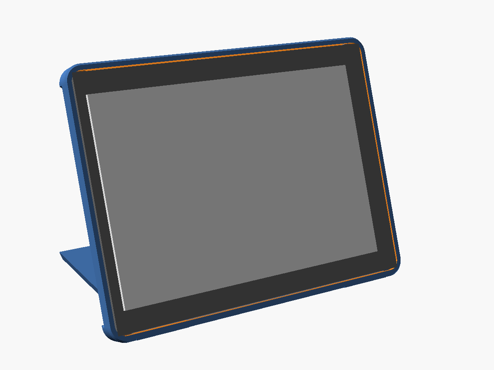
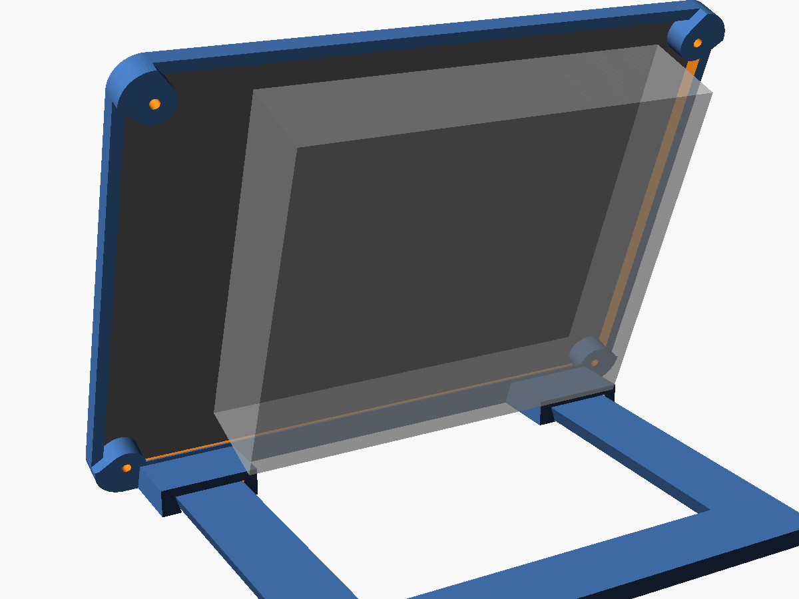
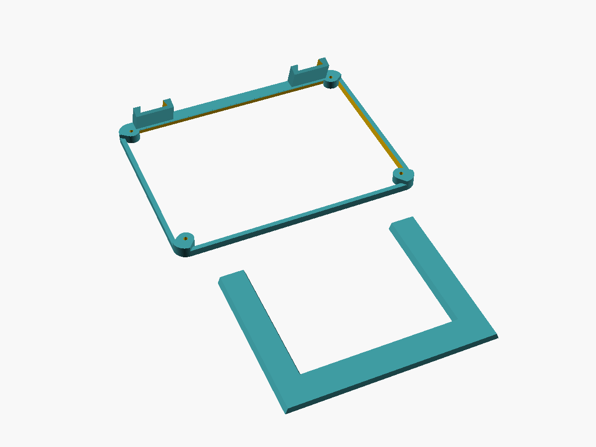

# Inky stand

A printable desk stand for the Inky Impression 4.0" (Spectra 6) e-ink panel:
a slim bumper around the board, leaning 20° back on a foot that slides out,
so the two pack flat to travel.

- **The panel shows as it is.** The bumper covers nothing on the front: the
  panel's own thin black border, its glass and its print all show, inside a
  2 mm rim, flush with the board's face.
- **Only the four corners touch the board.** The board drops in from the
  front and screws through its corner holes into pads behind its corners;
  the screw heads show at the corners, as on the bare board. The back stays
  open, so the Hack3r and the buttons on the back are free.
- **The foot slides in and out.** It's a U: two arms joined at the back,
  open at the front for the cable to the Pi. The arms are dovetails that
  slide into two sockets behind the board's bottom edge. They set the lean,
  and the foot comes with the stand when you lift it; pull the foot
  straight back to take it off.

## Print

Two parts, both ready to print as they are, with no supports:

| File | Lies on | Size |
|---|---|---|
| `inky-stand-frame.stl` | its front, the pads and sockets rising from it | 108 × 83 mm, 17 mm tall |
| `inky-stand-foot.stl` | its top, upside down | 87 × 68 mm, 3 mm thick |

- PLA or PETG, 0.2 mm layers, 3 walls, 20% infill. Matte black matches the
  panel's black border.
- The four corner pads print as short bridges across the corners; the rail
  along the bottom slopes at 45°. Neither needs supports.
- **Try the fit before anything else:** slide the foot into the sockets. It
  should go in with a firm push and not wobble. If it won't go in, set
  `fit` to `0.3` and print the foot again (only the foot); if it's loose,
  `0.1`. Sanding the arms' sides works for a small difference.

## Put it together

1. Lay the bumper face down, with the foot out. Lay the panel face down in
   it: the board drops into the rim, its corners on the four pads.
2. Turn it over, keeping the board in place. Four **M2 × 5 mm** screws, from
   the front, through the board's corner holes into the pads. They cut their
   own thread, so stop when they're snug.
3. Plug the cable back in.
4. Slide the foot's arms into the sockets until they stop, and stand it up.

**To travel:** pull the foot straight out backwards. The bumper (with the
panel in it) and the foot lie flat.

**Pressing the buttons:** A to D are on the back, along the left edge (as you
face the screen). The stand is light, so a one-finger push on a button from
behind can tip it forward. Pinch instead, with your thumb on the front and
your finger on the button, or stick the foot down with museum gel.

## Change it

`inky-stand.scad` is the source. Open it in [OpenSCAD](https://openscad.org),
change the settings at the top (the Customizer lists them), then export with
**Render** (F6) and **Export as STL**: once with `layout = "frame"`, once
with `layout = "foot"`. `layout = "desk"` shows the stand upright, with the
board and the Hack3r in place to check the fit; `"flat"` shows both parts as
they print.

| Setting | Default | |
|---|---|---|
| `tilt` | `20` | Degrees back from upright. Print both parts again after changing it |
| `fit` | `0.2` | Gap around each arm in its socket. More if the foot won't go in, less if it's loose |
| `buttons_side` | `left` | As you face the screen. Set `right` if your buttons are on the other side |
| `wall` | `2` | The rim's width, all round |
| `gap` | `0.5` | Clearance around the board. More if it won't drop in |
| `pilot_d` | `1.7` | Screw holes. Use `1.6` if the screws are loose, `1.8` if they're hard to turn |
| `foot_depth` | `70` | How far the foot reaches back |

Measured on a real panel: the board is 103 × 78 mm (Pimoroni's drawing),
with holes 3 mm in from each corner; the screen stands under 1.5 mm proud of
it; the Hack3r on the back starts 7.6 mm up from the bottom edge and stands
about 16 mm off the back. The sockets keep at least 1 mm from it.
